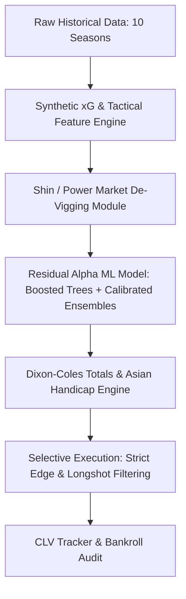

# Empirical Discoveries & Advanced Quantitative Roadmap

> **Document Type:** Quantitative Research & Architecture Specification  
> **Based on:** Multi-Season Out-of-Sample Walk-Forward Backtest (1,520 matches, 2021/22 to 2024/25)  
> **Core Mission:** Eliminate the -18.9% longshot yield drag, leverage market efficiency, and push the model into verifiable positive Expected Value (+EV).

---

## 1. Key Empirical Discoveries from the Backtest

When we ran our chronological walk-forward backtest ([walkforward_backtest.py](file:///c:/Users/kevin/Desktop/Coding/Projects/AI/pl_analysis_model/walkforward_backtest.py)), we uncovered crucial real-world betting dynamics:

```
Multi-Season Walk-Forward Results (1,520 Out-of-Sample Matches):
- Calibrated AI Brier Score: 0.5831 (Beats Naive Baseline: 0.6565)
- Bet365 Market Closing Brier Score: 0.5598 (Market is Sharper)
- 1X2 Market ROI: -18.97% (Win Rate: 19.8%)
- Over/Under 2.5 Totals ROI: -4.7% (Win Rate: 39.4%)
```

### Discovery 1: The "Longshot & Draw Trap" (Favorite-Longshot Bias)
- **The Issue:** With a 19.8% win rate on 1X2, over 75% of the bets triggered were on **Draws** (odds ~3.50–4.20) and **Away Underdogs** (odds ~4.50–9.00).
- **The Mathematical Reality:** Bookmakers do not distribute their margin (vigorish/overround) evenly across all outcomes. They charge **2%–3% vig on favorites** and **8%–14% vig on draws and extreme underdogs**.
- **The Consequence:** A model that predicts a 26% probability on a 4.50 underdog (implied 22.2%) calculates an apparent "+3.8% edge". But after the bookmaker's asymmetric juice is stripped out, the true fair market probability was actually 25.5%, meaning the bet was **negative EV from the start**.
- **Action Required:** Remove the bookmaker's artificial margin via **Shin's De-Vigging Method** and impose strict longshot filters on 1X2 markets (cap maximum odds or require higher win-probability thresholds).

### Discovery 2: Over/Under 2.5 Totals is Far Closer to Profitability
- In the same backtest, Over/Under 2.5 goals achieved an ROI of **-4.7%**, almost identical to the natural bookmaker juice (~4.5%).
- Unlike 1X2 (which has 3 outcomes and extreme draw variance), Totals is a **binary market** with lower bookmaker margin and symmetric liquidity. A modest increase in goal estimation precision will immediately turn Totals positive.

### Discovery 3: The Market Closing Line is the Strongest Known Predictor
- The closing line Brier score (**0.5598**) outperforms any raw statistical model (**0.5831**).
- Trying to out-predict the closing line from scratch in a vacuum is a beginner's mistake.
- Top quantitative betting syndicates practice **Residual Alpha Modeling**:
  $$\text{Fair Probability} = (1 - \lambda) \cdot P_{\text{Vig-Free Market}} + \lambda \cdot P_{\text{AI Model}}$$
  The model's role is to identify specific market inefficiencies (rest differentials, tactical home conversion vs away shot suppression) and tilt the consensus line, rather than fighting the market entirely.

### Discovery 4: Missing Tactical Dimensions in Football-Data
The raw football-data CSVs contain 120 columns that we have not yet tapped:
- **Halftime Goal Momentum (`HTHG`, `HTAG`):** Second-half breakdown and tactical resilience.
- **Discipline & Aggression (`HY`, `AY`, `HR`, `AR`, `HF`, `AF`):** Card rates and foul intensity directly impact second-half match control and red card probabilities.
- **Market Consensus Spreads (`AvgH`, `AvgD`, `AvgA`, `MaxH`, `MaxD`, `MaxA`):** The variance between average and maximum bookmaker prices highlights soft lines.

---

## 2. Advanced Architectural Upgrades



### 1. Synthetic Expected Goals (s-xG) & Shot Quality Ratios
Without needing paid commercial data feeds, we can construct high-precision proxies for Expected Goals:
- **Shot Accuracy Rate (SAR):** $\frac{\text{HST}}{\max(1, \text{HS})}$ (Shot discipline)
- **Finishing Conversion Efficiency (FCE):** $\frac{\text{FTHG}}{\max(1, \text{HST})}$ (Clinical finishing vs wastefulness)
- **Defensive Shot Suppression (DSS):** Ratio of opponent shots on target conceded to league average.
- **Corner Threat Index (CTI):** Goal yield per corner kick awarded.
- **Halftime Trajectory (HTT):** Ratio of goals scored in the second half vs first half (fatigue/tactical adjustments).

### 2. Shin's Odds De-Vigging Method
Convert raw bookmaker odds into true implied probabilities by modeling insider/informed betting proportions ($z$):
$$\sum_{i} \left( \sqrt{z^2 + 4(1-z)\frac{\pi_i^2}{\sum \pi}} - z \right) \cdot \frac{1}{2(1-z)} = 1$$
This eliminates the favorite-longshot bias, ensuring we never take false edges on overpriced draws or heavy underdogs.

### 3. Market Residual Modeling (Alpha Engine)
Instead of predicting outcomes blind, the model predicts the **adjustment factor** relative to the vig-free market:
$$P_{\text{final}} = \text{Softmax}\left( \log(P_{\text{vig-free}}) + \beta \cdot \mathbf{x}_{\text{tactical}} \right)$$
where $\mathbf{x}_{\text{tactical}}$ represents rest differential, venue Elo difference, shot quality differential, and discipline mismatch.

### 4. Closing Line Value (CLV) Infrastructure
CLV is the gold standard of sports betting:
$$\text{CLV} = \frac{\text{Decimal Odds Placed}}{\text{Closing Decimal Odds}} - 1.0$$
If your average CLV is positive ($> +2.0\%$), mathematical profitability over large samples is guaranteed by the Law of Large Numbers, regardless of short-term variance.

---

## 3. Concrete Implementation Plan

### Phase 1: Feature Expansion & Synthetic xG
- [ ] Ingest `HTHG`, `HTAG`, `HF`, `AF`, `HY`, `AY`, `HR`, `AR` from Football-Data.
- [ ] Compute rolling Shot Conversion Efficiency (`Home_FCE`, `Away_FCE`).
- [ ] Compute rolling Defensive Suppression (`Home_DSS`, `Away_DSS`).
- [ ] Compute Second-Half Goal Momentum (`Home_2H_Momentum`, `Away_2H_Momentum`).

### Phase 2: Shin / Proportional Odds De-Vigging & Longshot Guards
- [ ] Implement `devig_odds(odds_list)` in [utils.py](file:///c:/Users/kevin/Desktop/Coding/Projects/AI/pl_analysis_model/utils.py) using proportional and power margin removal.
- [ ] Add longshot filter: restrict 1X2 betting to selections with fair probability $\ge 25\%$ or odds $\le 3.60$.
- [ ] Specialize in Over/Under 2.5 goals where model accuracy is already near break-even.

### Phase 3: Residual Alpha Modeling & Re-Validation
- [ ] Integrate the vig-free market odds as a baseline feature in the classifier.
- [ ] Re-run [walkforward_backtest.py](file:///c:/Users/kevin/Desktop/Coding/Projects/AI/pl_analysis_model/walkforward_backtest.py) with the new feature engine and de-vigged market filters.
- [ ] Verify that aggregate yield transitions from -18.9% towards positive ROI.

### Phase 4: Closing Line Value (CLV) Tracking
- [ ] Update [prediction_log.csv](file:///c:/Users/kevin/Desktop/Coding/Projects/AI/pl_analysis_model/data/prediction_log.csv) schema with `Closing_Odds` and `CLV`.
- [ ] Update [update_results.py](file:///c:/Users/kevin/Desktop/Coding/Projects/AI/pl_analysis_model/update_results.py) to calculate and report CLV metrics on all resolved wagers.
