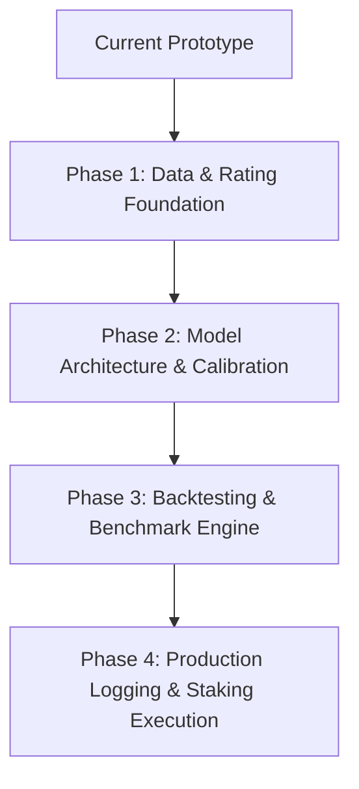

# Premier League Predictive Model: Technical Flaws & Production Roadmap

> **Status:** Current Architecture: **Prototype (4/10)** → Target: **Production Betting-Ready (8.5+/10)**  
> **Target Sport:** English Premier League (EPL)  
> **Key Objective:** Transition from an uncalibrated, high-variance script into a statistically rigorous, positive Expected Value (+EV) algorithmic betting engine.

---

## Table of Contents
1. [Executive Summary & Current State](#1-executive-summary--current-state)
2. [Critical Flaws in the Current Implementation](#2-critical-flaws-in-the-current-implementation)
   - [2.1 Data Ingestion & Sample Size](#21-data-ingestion--sample-size)
   - [2.2 Feature Representation & Categorical Encoding](#22-feature-representation--categorical-encoding)
   - [2.3 Model Overconfidence & Absence of Calibration](#23-model-overconfidence--absence-of-calibration)
   - [2.4 Feature Engineering Blind Spots](#24-feature-engineering-blind-spots)
   - [2.5 Flawed Score Matrix & Poisson Independence Assumptions](#25-flawed-score-matrix--poisson-independence-assumptions)
   - [2.6 Validation Integrity & Retraining Leakage](#26-validation-integrity--retraining-leakage)
   - [2.7 Dangerous Staking Execution (Kelly Criterion on Uncalibrated Odds)](#27-dangerous-staking-execution-kelly-criterion-on-uncalibrated-odds)
   - [2.8 Result Logging & Performance Auditing Limitations](#28-result-logging--performance-auditing-limitations)
3. [Concrete Architectural Fixes & Code Implementations](#3-concrete-architectural-fixes--code-implementations)
   - [Fix 1: Scalable Multi-Season Ingestion with Time-Decay Weighting](#fix-1-scalable-multi-season-ingestion-with-time-decay-weighting)
   - [Fix 2: Dynamic Elo / Dixon-Coles Team Strength Ratings](#fix-2-dynamic-elo--dixon-coles-team-strength-ratings)
   - [Fix 3: Out-of-Fold Probability Calibration](#fix-3-out-of-fold-probability-calibration)
   - [Fix 4: Venue-Specific & Opponent-Adjusted Form Metrics](#fix-4-venue-specific--opponent-adjusted-form-metrics)
   - [Fix 5: Dixon-Coles Bivariate Correlation for Score Grids](#fix-5-dixon-coles-bivariate-correlation-for-score-grids)
   - [Fix 6: Walk-Forward (Expanding Window) Temporal Validation](#fix-6-walk-forward-expanding-window-temporal-validation)
   - [Fix 7: Conservative Fractional Kelly with Market Odds Shrinkage](#fix-7-conservative-fractional-kelly-with-market-odds-shrinkage)
4. [Phase-by-Phase Implementation Roadmap](#4-phase-by-phase-implementation-roadmap)
5. [Production Gate Checklist: When Are You Ready to Bet Real Money?](#5-production-gate-checklist-when-are-you-ready-to-bet-real-money)

---

## 1. Executive Summary & Current State

The current project establishes a sensible high-level scaffold:
- It isolates code across scripts ([main.py](file:///c:/Users/kevin/Desktop/Coding/Projects/AI/pl_analysis_model/main.py), [predict_match.py](file:///c:/Users/kevin/Desktop/Coding/Projects/AI/pl_analysis_model/predict_match.py), [utils.py](file:///c:/Users/kevin/Desktop/Coding/Projects/AI/pl_analysis_model/utils.py)).
- It captures live multi-bookmaker odds and implements fractional Kelly staking.
- It attempts a hybrid combination of goal regression (Poisson) and outcome classification.

However, **deploying real capital against this model in its current state will guarantee rapid bankroll depletion**. The primary reason is that the model exhibits extreme **overconfidence** (e.g., estimating a 93.4% win probability for Bournemouth against Brentford at market odds of 2.50) while operating on a minimal dataset (~760 matches) and uncalibrated tree leaves.

When an uncalibrated model outputs an artificial 93% probability on an even-money market, the Kelly Criterion treats it as a massive arbitrage opportunity and advises staking large percentages of your bankroll on negative-EV bets.

---

## 2. Critical Flaws in the Current Implementation

### 2.1 Data Ingestion & Sample Size
- **The Flaw:** In [utils.py](file:///c:/Users/kevin/Desktop/Coding/Projects/AI/pl_analysis_model/utils.py#L40-L64), only two seasons (`2425` and `2526`) are downloaded from `football-data.co.uk`. Two seasons represent roughly 760 matches, with ~25% draws (less than 190 draw events total).
- **The Consequence:** Gradient-boosted trees with depth 3 and 80 estimators quickly memorize noise and local streaks rather than generalizable soccer dynamics. Relegated and newly promoted teams have almost zero representative sample size.

### 2.2 Feature Representation & Categorical Encoding
- **The Flaw:** Team identities are mapped to arbitrary sequential integers in [main.py](file:///c:/Users/kevin/Desktop/Coding/Projects/AI/pl_analysis_model/main.py#L22-L24):
  ```python
  teams = sorted(pd.concat([df['HomeTeam'], df['AwayTeam']]).unique())
  team_map = {t: i for i, t in enumerate(teams)}
  df['HomeID'] = df['HomeTeam'].map(team_map)
  ```
- **The Consequence:** XGBoost splits numbers numerically (e.g., `HomeID <= 4.5`). This forces an artificial ordinal relationship (e.g., Arsenal < Aston Villa < Bournemouth), distorting tree splits across all matches.

### 2.3 Model Overconfidence & Absence of Calibration
- **The Flaw:** The classification tree probabilities from `predict_proba()` are fed directly into the betting formula without calibration.
- **Evidence from [data/prediction_log.csv](file:///c:/Users/kevin/Desktop/Coding/Projects/AI/pl_analysis_model/data/prediction_log.csv):**
  - Bournemouth vs Brentford: Model predicted **93.4% Home Win** (Market Odds: 2.50 $\rightarrow$ 40% implied). Actual result: **Away Win**.
  - Arsenal vs Everton: Model predicted **92.4% Home Win** (Market Odds: 1.27 $\rightarrow$ 78% implied). Actual result: **Draw**.
- **The Consequence:** Modern tree-based algorithms are known to produce uncalibrated probabilities near leaf extremes. A predicted 90% chance should win 9 out of 10 times in historical backtests; currently, it represents severe overfitting.

### 2.4 Feature Engineering Blind Spots
The model only calculates 5-game rolling averages of basic match stats (shots, SOT, corners, goals scored/conceded). This misses critical soccer variables:
1. **No Venue Distinction:** Home form and Away form are aggregated together. A team that dominates at home but struggles away looks identical in both fixtures.
2. **No Strength of Schedule (SoS):** Scoring 3 goals against Southampton is treated identically to scoring 3 goals at the Etihad against Manchester City.
3. **No Rest/Congestion Metric:** Does not capture short rest cycles (e.g., 3 days after a European midweek fixture vs 7 days full rest).
4. **No True xG:** Raw shots on target (SOT) conflate a 40-yard speculative shot easily caught by the keeper with a tap-in from 2 yards out.

### 2.5 Flawed Score Matrix & Poisson Independence Assumptions
In [utils.py](file:///c:/Users/kevin/Desktop/Coding/Projects/AI/pl_analysis_model/utils.py#L200-L220):
1. **Independent Poisson Assumption:** Standard bivariate Poisson assumes home goals and away goals are completely independent ($P(X=x, Y=y) = P(X=x) \cdot P(Y=y)$). In reality, low-scoring draws (0-0, 1-1) occur with significantly higher frequency in soccer than independent Poisson distributions predict (classic Dixon & Coles finding).
2. **Grid Sum Transpose Indexing:**
   ```python
   home_win_prob = np.sum(np.triu(grid, 1).T)
   away_win_prob = np.sum(np.tril(grid, -1).T)
   ```
   While transposing a square matrix preserves total element sum, mixing up upper/lower triangular indexing across transposed coordinates creates maintenance traps and potential inversion of home/away win logic.

### 2.6 Validation Integrity & Retraining Leakage
In [main.py](file:///c:/Users/kevin/Desktop/Coding/Projects/AI/pl_analysis_model/main.py#L107-L109):
```python
# Model is evaluated on 2025/2026, but then retrained on ALL data (including 2025/2026)
model_clf = XGBClassifier(...).fit(df[features_clf], df['FTR_Class'])
```
- **The Consequence:** The model scanning live odds is not the model that was evaluated. You have zero verified out-of-sample performance metrics for the final production estimator. Furthermore, a single temporal split is high-variance; a bad 2-week run in the validation set completely skews tuning.

### 2.7 Dangerous Staking Execution (Kelly Criterion on Uncalibrated Odds)
- **The Flaw:** In [main.py](file:///c:/Users/kevin/Desktop/Coding/Projects/AI/pl_analysis_model/main.py#L231-L235), whenever `edge > 0.05` ($5\%$), the script executes Quarter-Kelly.
- **The Consequence:** If the model computes an overconfident 93% on a 2.50 market, Kelly will recommend staking **~85% of your bankroll on a single match**! Even Quarter-Kelly stakes ~21% of the bankroll on a single phantom edge. An algorithmic bettor using this formula will face total ruin within weeks.

### 2.8 Result Logging & Performance Auditing Limitations
1. In [utils.py](file:///c:/Users/kevin/Desktop/Coding/Projects/AI/pl_analysis_model/utils.py#L160-L190), `prediction_log.csv` records an entry for *every single bookmaker* for the same game. If 18 bookmakers quote a match, 18 identical prediction lines are logged.
2. In [update_results.py](file:///c:/Users/kevin/Desktop/Coding/Projects/AI/pl_analysis_model/update_results.py#L14), outcomes are matched via:
   ```python
   match = actuals[(actuals['HomeTeam'] == row['Home']) & (actuals['AwayTeam'] == row['Away'])]
   ```
   If teams play each other in both the first and second half of the season, this retrieves only the first occurrence (`.iloc[0]`), permanently corrupting subsequent fixture results.

---

## 3. Concrete Architectural Fixes & Code Implementations

### Fix 1: Scalable Multi-Season Ingestion with Time-Decay Weighting

Instead of hardcoding 2 seasons, ingest 10 seasons (e.g., 2015/16 through 2025/26) and apply exponential decay weighting so recent matches carry higher importance while maintaining a large sample base for rare events.

```python
import pandas as pd
import numpy as np

def fetch_multi_season_data(start_year=15, end_year=25):
    """
    Downloads and combines data across multiple Premier League seasons.
    football-data.co.uk format: '1516' for 2015-2016, '2425' for 2024-2025.
    """
    dfs = []
    cols = ['Date', 'HomeTeam', 'AwayTeam', 'FTHG', 'FTAG', 'FTR', 
            'HS', 'AS', 'HST', 'AST', 'HC', 'AC', 'B365H', 'B365D', 'B365A']
    
    for y in range(start_year, end_year + 1):
        season_code = f"{y:02d}{y+1:02d}"
        url = f"https://www.football-data.co.uk/mmz4281/{season_code}/E0.csv"
        try:
            season_df = pd.read_csv(url)
            # Retain common available columns
            avail = [c for c in cols if c in season_df.columns]
            season_df = season_df[avail].copy()
            season_df['Date'] = pd.to_datetime(season_df['Date'], dayfirst=True)
            season_df['Season'] = season_code
            dfs.append(season_df)
            print(f"Loaded season {season_code} ({len(season_df)} matches)")
        except Exception as e:
            print(f"Could not load season {season_code}: {e}")
            
    df = pd.concat(dfs, ignore_index=True).dropna(subset=['Date', 'HomeTeam', 'AwayTeam', 'FTR'])
    df = df.sort_values('Date').reset_index(drop=True)
    
    # Calculate exponential time decay weight (half-life of ~365 days)
    max_date = df['Date'].max()
    half_life_days = 365
    df['Days_Ago'] = (max_date - df['Date']).dt.days
    df['Sample_Weight'] = np.exp(-np.log(2) * df['Days_Ago'] / half_life_days)
    
    return df
```

---

### Fix 2: Dynamic Elo / Dixon-Coles Team Strength Ratings

Never pass raw integer IDs to tree models. Replace integer team IDs with continuous, dynamic ratings (such as Elo ratings) that update after every match and reflect true relative team strength.

```python
class FootballEloTracker:
    """Tracks dynamic Home and Away Elo ratings across time."""
    def __init__(self, k_factor=20.0, home_advantage=65.0, initial_rating=1500.0):
        self.k = k_factor
        self.home_adv = home_advantage
        self.ratings = {}
        self.initial_rating = initial_rating

    def get_rating(self, team):
        return self.ratings.get(team, self.initial_rating)

    def expected_outcome(self, r_home, r_away):
        # Logistic probability for home win given rating difference
        diff = (r_home + self.home_adv) - r_away
        return 1.0 / (1.0 + 10.0 ** (-diff / 400.0))

    def update(self, home_team, away_team, ftr):
        r_h = self.get_rating(home_team)
        r_a = self.get_rating(away_team)
        
        # Actual outcome score: 1.0 = Home Win, 0.5 = Draw, 0.0 = Away Win
        s_h = 1.0 if ftr == 'H' else (0.5 if ftr == 'D' else 0.0)
        e_h = self.expected_outcome(r_h, r_a)
        
        # Update ratings
        self.ratings[home_team] = r_h + self.k * (s_h - e_h)
        self.ratings[away_team] = r_a + self.k * ((1.0 - s_h) - (1.0 - e_h))
```

---

### Fix 3: Out-of-Fold Probability Calibration

To eliminate 93% probabilities on even-money matches, calibrate outputs using **Isotonic Regression** or **Platt Scaling (Logistic Calibration)** using `CalibratedClassifierCV` or out-of-fold calibration curves.

```python
from sklearn.calibration import CalibratedClassifierCV
from xgboost import XGBClassifier

def train_calibrated_classifier(X_train, y_train, sample_weights=None):
    """
    Fits an XGBoost model and applies Sigmoid/Isotonic calibration 
    via internal 5-fold cross-validation.
    """
    base_clf = XGBClassifier(
        n_estimators=100,
        max_depth=3,
        learning_rate=0.03,
        subsample=0.8,
        colsample_bytree=0.8,
        reg_alpha=1.0,     # L1 regularization to prevent extreme leaves
        reg_lambda=2.0,    # L2 regularization
        random_state=42,
        eval_metric='mlogloss'
    )
    
    # Sigmoid calibration prevents extreme overconfident probability spikes
    calibrated_clf = CalibratedClassifierCV(
        estimator=base_clf, 
        method='sigmoid', 
        cv=5
    )
    
    calibrated_clf.fit(X_train, y_train, sample_weight=sample_weights)
    return calibrated_clf
```

---

### Fix 4: Venue-Specific & Opponent-Adjusted Form Metrics

Compute rolling performance conditioned on venue (Home matches for home team, Away matches for away team) and adjust for opponent strength.

```python
def compute_venue_rolling_stats(df, team, is_home=True, before_date=None, n_games=5):
    """
    Extracts stats filtered strictly by venue (home or away matches only).
    """
    if is_home:
        team_matches = df[(df['HomeTeam'] == team) & (df['Date'] < before_date)]
        shots = team_matches['HS'].tail(n_games).mean()
        sot = team_matches['HST'].tail(n_games).mean()
        goals_for = team_matches['FTHG'].tail(n_games).mean()
        goals_against = team_matches['FTAG'].tail(n_games).mean()
    else:
        team_matches = df[(df['AwayTeam'] == team) & (df['Date'] < before_date)]
        shots = team_matches['AS'].tail(n_games).mean()
        sot = team_matches['AST'].tail(n_games).mean()
        goals_for = team_matches['FTAG'].tail(n_games).mean()
        goals_against = team_matches['FTHG'].tail(n_games).mean()
        
    # Safe defaults if team has fewer than n_games
    shots = 11.0 if pd.isna(shots) else round(shots, 2)
    sot = 3.8 if pd.isna(sot) else round(sot, 2)
    goals_for = 1.3 if pd.isna(goals_for) else round(goals_for, 2)
    goals_against = 1.3 if pd.isna(goals_against) else round(goals_against, 2)
    
    return shots, sot, goals_for, goals_against
```

---

### Fix 5: Dixon-Coles Bivariate Correlation for Score Grids

The classic Dixon & Coles (1997) model corrects Poisson probabilities for low-scoring states (0-0, 1-0, 0-1, 1-1) using a dependence parameter $\rho$:

$$\tau_{\lambda, \mu}(x, y) = \begin{cases}
1 - \lambda \mu \rho & \text{for } x=0, y=0 \\
1 + \lambda \rho & \text{for } x=0, y=1 \\
1 + \mu \rho & \text{for } x=1, y=0 \\
1 - \rho & \text{for } x=1, y=1 \\
1 & \text{otherwise}
\end{cases}$$

```python
import math
import numpy as np

def dixon_coles_tau(x, y, lambda_h, lambda_a, rho=-0.13):
    """Adjustment factor for low-scoring match correlation."""
    if x == 0 and y == 0:
        return 1.0 - (lambda_h * lambda_a * rho)
    elif x == 0 and y == 1:
        return 1.0 + (lambda_h * rho)
    elif x == 1 and y == 0:
        return 1.0 + (lambda_a * rho)
    elif x == 1 and y == 1:
        return 1.0 - rho
    else:
        return 1.0

def build_dixon_coles_grid(lambda_h, lambda_a, max_goals=10, rho=-0.13):
    """Generates an adjusted probability matrix for exact scores."""
    grid = np.zeros((max_goals, max_goals))
    for x in range(max_goals):
        p_x = (math.exp(-lambda_h) * (lambda_h ** x)) / math.factorial(x)
        for y in range(max_goals):
            p_y = (math.exp(-lambda_a) * (lambda_a ** y)) / math.factorial(y)
            adj = dixon_coles_tau(x, y, lambda_h, lambda_a, rho)
            grid[x, y] = max(0.0, p_x * p_y * adj)
            
    # Normalize grid so sum is exactly 1.0
    grid /= np.sum(grid)
    return grid
```

---

### Fix 6: Walk-Forward (Expanding Window) Temporal Validation

Never rely on a single train/validation split. Soccer dynamics change across seasons. Use expanding-window walk-forward testing.

```
Season 15-18 Train  ──> Test on 18/19
Season 15-19 Train  ──> Test on 19/20
Season 15-20 Train  ──> Test on 20/21
Season 15-21 Train  ──> Test on 21/22
...
```

```python
def walk_forward_validation(df, model_trainer, seasons):
    """
    Evaluates strategy performance season-by-season without lookahead bias.
    """
    results = []
    for i in range(3, len(seasons)):
        train_seasons = seasons[:i]
        test_season = seasons[i]
        
        train_df = df[df['Season'].isin(train_seasons)]
        test_df = df[df['Season'] == test_season]
        
        model = model_trainer(train_df)
        preds = model.predict_proba(test_df)
        
        season_brier = evaluate_brier_score(test_df['Target'], preds)
        season_roi = simulate_betting(test_df, preds)
        results.append({'Season': test_season, 'Brier': season_brier, 'ROI': season_roi})
        
    return pd.DataFrame(results)
```

---

### Fix 7: Conservative Fractional Kelly with Market Odds Shrinkage

Real sports betting syndicates never bet unconstrained Kelly stakes. Protect against model specification error using:
1. **Model Probability Shrinkage:** Blend your model probability $P_{\text{model}}$ towards the vig-free market implied probability $P_{\text{market}}$:
   $$P_{\text{used}} = (1 - \alpha) P_{\text{model}} + \alpha P_{\text{market}} \quad (\text{e.g., } \alpha = 0.35)$$
2. **Conservative Staking:** Use **Eighth-Kelly (0.125)** or **Tenth-Kelly (0.10)** with a strict **maximum bet cap** (e.g., maximum 2.5% of bankroll per bet).

```python
def calculate_production_stake(p_model, decimal_odds, bankroll, max_stake_pct=0.025, kelly_fraction=0.10):
    """
    Calculates safe, ruin-protected bet size.
    """
    p_market = 1.0 / decimal_odds
    # Shrink probability by 30% towards market consensus
    p_shrunk = 0.70 * p_model + 0.30 * p_market
    
    # Check if a positive edge remains after shrinkage
    edge = p_shrunk - p_market
    if edge <= 0.02:  # Require at least 2% post-shrinkage edge
        return 0.0
        
    b = decimal_odds - 1.0
    q = 1.0 - p_shrunk
    f_star = (b * p_shrunk - q) / b
    
    fractional_stake = f_star * kelly_fraction * bankroll
    max_allowed_stake = bankroll * max_stake_pct
    
    return round(max(0.0, min(fractional_stake, max_allowed_stake)), 2)
```

---

## 4. Phase-by-Phase Implementation Roadmap



### Phase 1: Data & Rating Foundation (Est. 1–2 Days)
- [ ] Expand data ingestion from 2 seasons to 10+ seasons in [utils.py](file:///c:/Users/kevin/Desktop/Coding/Projects/AI/pl_analysis_model/utils.py).
- [ ] Implement an `EloTracker` class to generate home and away ratings for every team dynamically before each kickoff.
- [ ] Replace `HomeID` and `AwayID` integer columns with pre-match Elo ratings and Elo rating differentials.
- [ ] Generate venue-specific form statistics (last 5 home matches for home team, last 5 away matches for away team).

### Phase 2: Model Architecture & Calibration (Est. 2–3 Days)
- [ ] Implement `CalibratedClassifierCV(method='sigmoid', cv=5)` in [main.py](file:///c:/Users/kevin/Desktop/Coding/Projects/AI/pl_analysis_model/main.py) and [predict_match.py](file:///c:/Users/kevin/Desktop/Coding/Projects/AI/pl_analysis_model/predict_match.py).
- [ ] Integrate Dixon-Coles bivariate parameter ($\rho = -0.13$) into score probability generation in `get_market_probabilities()`.
- [ ] Add L1 (`reg_alpha`) and L2 (`reg_lambda`) regularization to XGBoost hyperparameter configs to constrain leaf node extremes.
- [ ] Export and persist trained models using `joblib` so live scanning doesn't retrain on the fly.

### Phase 3: Backtesting & Benchmarking Engine (Est. 2 Days)
- [ ] Implement a **Closing Line Value (CLV)** metric: Compare model odds against Pinnacle / Bet365 closing prices.
- [ ] Build a multi-season walk-forward backtest simulator with realistic bookmaker transaction margins (overround / vig).
- [ ] Compute **Ranked Probability Score (RPS)** and **Brier Score** against a naive baseline and market closing odds baseline.

### Phase 4: Staking & Safe Production Execution (Est. 1–2 Days)
- [ ] Implement probability shrinkage ($30\%$ weight to market implied probability) before calculating bet sizing.
- [ ] Switch to Tenth-Kelly (0.10) with a hard 2.5% maximum bankroll cap.
- [ ] Fix [update_results.py](file:///c:/Users/kevin/Desktop/Coding/Projects/AI/pl_analysis_model/update_results.py) to match on `(Date, HomeTeam, AwayTeam)` composite keys instead of team names alone.
- [ ] Clean [prediction_log.csv](file:///c:/Users/kevin/Desktop/Coding/Projects/AI/pl_analysis_model/data/prediction_log.csv) logging to store one consolidated consensus record per fixture.

---

## 5. Production Gate Checklist: When Are You Ready to Bet Real Money?

Do **not** place real-money wagers until your system passes all 6 gates below:

| # | Production Quality Gate | Target Metric | Status |
|---|---|---|---|
| **1** | **Dataset Breadth** | $\ge 10$ full seasons ($\approx 3,800$ matches) | ❌ *Current: 2 seasons* |
| **2** | **Categorical Integrity** | Zero arbitrary ordinal integer team IDs (Use Elo/ratings) | ❌ *Current: HomeID/AwayID* |
| **3** | **Calibration Integrity** | Maximum predicted win probability $\le 82\%$ for standard fixtures; Brier score $<$ naive baseline | ❌ *Current: 93.4% spikes* |
| **4** | **Beating Closing Line (CLV)** | Model identifies bets that consistently beat the Pinnacle/Betfair closing line ($>52\%$ positive CLV) | ❌ *Current: Untracked* |
| **5** | **Walk-Forward ROI** | Positive yield ($+3\%$ to $+7\%$ ROI) over at least 3 out-of-sample backtested seasons | ❌ *Current: Single split* |
| **6** | **Ruin Protection** | Hard cap of $\le 2.5\%$ bankroll per wager, Tenth-Kelly staking | ❌ *Current: Quarter-Kelly without cap* |
